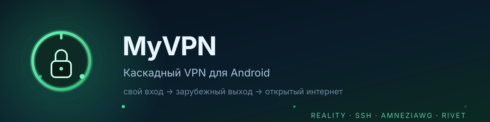
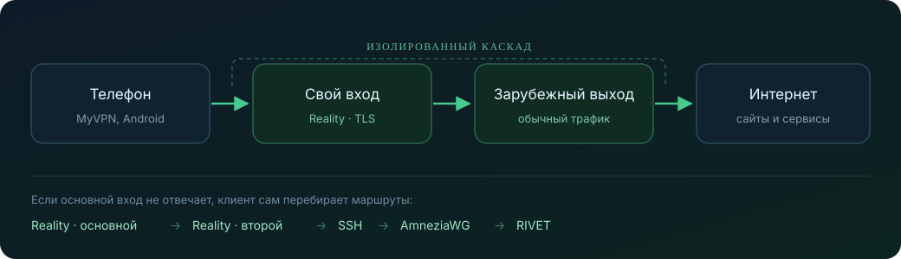
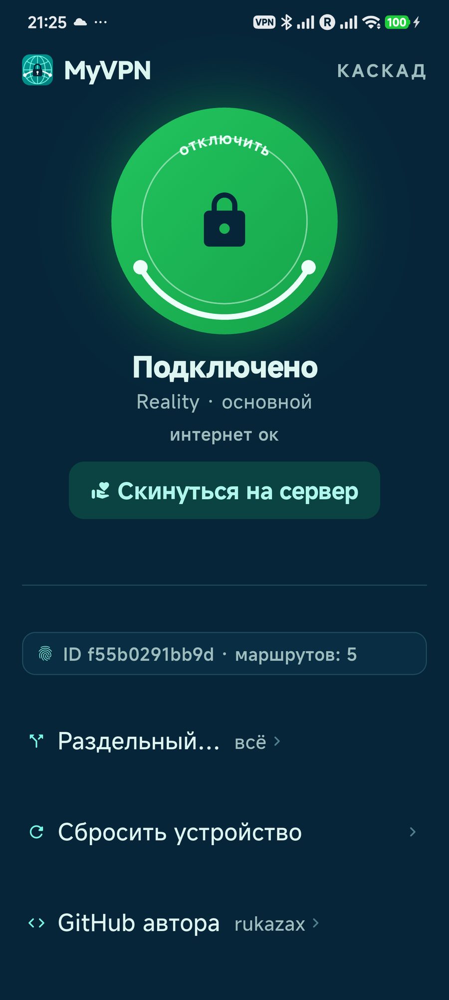
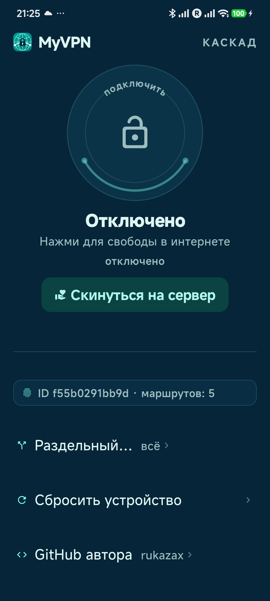
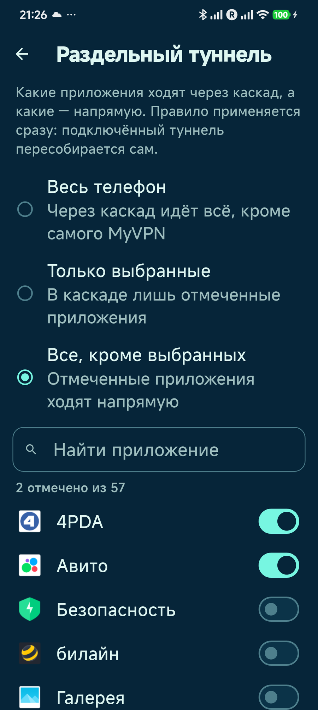
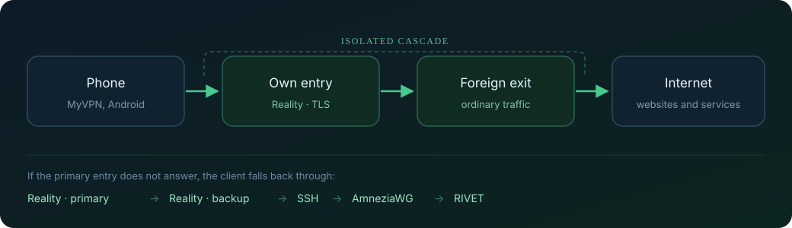

# MyVPN

**RU** · [English](#english)

<p align="center">
  
</p>

<p align="center">
  
  
  
</p>

VPN-клиент для Android, который не притворяется чужим сервером. Он строит каскад:
телефон подключается к своему входному узлу, тот уходит в зарубежный выход, и уже оттуда
трафик идёт в интернет. Снаружи виден только выходной адрес — ни вход, ни ключи не светятся.

Исходники живут в закрытом репозитории. Здесь — готовые сборки: скачал, поставил, работает.

## Скачать

<p align="center">
  <a href="https://github.com/rukazax/MyVPN-releases/releases/latest/download/MyVPN-1.2.5-android-arm64-v8a.apk">
    
  </a>
</p>

Один файл, одна ссылка. Android 8.0 и новее, 64-битный процессор. APK подписан и ставится
поверх прошлой версии — настройки и ключи остаются на месте.

## Что это такое

Обычный VPN — это один чужой сервер: подключился, и весь твой трафик виден его хозяину.
MyVPN делает иначе. У него **свой вход** — маленький узел, который не выглядит как VPN-сервис,
и **зарубежный выход**, с которого трафик уходит в интернет как обычный. Между ними —
изолированный каскад, к которому нет публичного доступа.

Что это даёт на практике:

- **Никто не видит, кто ты.** Провайдер видит соединение с ничем не примечательным узлом,
  а сайты — только зарубежный адрес.
- **Нет общего аккаунта.** При первом запуске приложение само получает отдельного пользователя:
  свой ID, ключи и маршруты. Сбросить устройство — значит выдать новые.
- **Нет ручной настройки.** Ни конфигов, ни серверов, ни паролей. Большая кнопка — и всё.

## Как это работает

<p align="center">
  
</p>

- **Reality на входе.** Соединение маскируется под обычный TLS-трафик к чужому сайту: снаружи
  его не отличить от визита в интернет.
- **Перебор маршрутов.** Если основной вход не отвечает, клиент сам пробует следующий:
  Reality (второй вход) → SSH → AmneziaWG → RIVET. Падать некуда — один из них поднимется.
- **Раздельный туннель.** Можно пустить через каскад весь телефон, только выбранные приложения
  или всё, кроме выбранных. Правило применяется сразу, туннель пересобирается сам.
- **Плитка в шторке.** Включить и выключить туннель можно, не открывая приложение.

## Возможности

| | |
|---|---|
| Подключение в один тап | Большая кнопка, статус, задержка и текущий маршрут |
| Перебор маршрутов | Reality (два входа) → SSH → AmneziaWG → RIVET |
| Ключи на устройство | Отдельный пользователь выдаётся автоматически при первом запуске |
| Раздельный туннель | Весь телефон / только выбранные / всё, кроме выбранных |
| Плитка в шторке | Туннель включается без открытия приложения |
| Тёмная и светлая тема | Переключается по системной настройке |
| Минимум настроек | Ни серверов, ни конфигов, ни паролей |

## Установка

1. **Скачайте APK** по кнопке выше — файл `MyVPN-1.2.5-android-arm64-v8a.apk`.
2. **Разрешите установку** из этого источника, когда Android спросит. На Xiaomi/HyperOS
   дополнительно включите «Установка через USB» в настройках разработчика.
3. **Откройте MyVPN и нажмите большую кнопку.** Приложение попросит разрешение на VPN —
   это системный диалог Android, без него туннель не поднять. Ключи выдадутся сами.

Готово: сверху появится «Подключено», а в строке состояния — значок ключа.

## Скриншоты

<p align="center">
  
  
  
</p>

## Проверка файла

Если хочется убедиться, что скачался ровно тот файл:

```
sha256sum MyVPN-1.2.5-android-arm64-v8a.apk
```

Должно получиться:

```
31522b44a9b634b0f1b1d38555218004615dc501b838e02f8258d2a04cc12da0
```

## English

[**RU**](#myvpn) · **English**

VPN client for Android that does not pretend to be someone else's server. It builds a cascade:
the phone connects to its own entry node, that node goes out through a foreign exit, and only
from there the traffic reaches the internet. From the outside only the exit address is visible —
neither the entry nor the keys are exposed.

The source code lives in a private repository. This one holds ready-to-install builds.

### Download

One download button, at the top of this page. One file, one link. Android 8.0+ on a 64-bit CPU.
The APK is signed and installs over the previous version — settings and keys stay in place.

### What it is

A regular VPN is one foreign server: connect, and the whole traffic is visible to its owner.
MyVPN works differently. It has its **own entry** — a small node that doesn't look like a VPN
service — and a **foreign exit** that sends traffic to the internet as ordinary web traffic.
Between them runs an isolated cascade with no public access.

- **Nobody sees who you are.** Your ISP sees a connection to an unremarkable node; websites see
  only the foreign address.
- **No shared account.** On first launch the app obtains a dedicated user: its own ID, keys and
  routes. Resetting the device means issuing new ones.
- **No manual setup.** No configs, no servers, no passwords. One big button.

### How it works

<p align="center">
  
</p>

- **Reality at the entry.** The connection is disguised as ordinary TLS traffic to a third-party
  site — indistinguishable from a regular visit.
- **Route fallback.** If the primary entry doesn't answer, the client tries the next one:
  Reality (second entry) → SSH → AmneziaWG → RIVET. One of them will come up.
- **Split tunneling.** Route the whole phone, only selected apps, or everything except selected
  apps. The rule applies instantly and the tunnel is rebuilt automatically.
- **Quick Settings tile.** Toggle the tunnel without opening the app.

### Features

| | |
|---|---|
| One-tap connect | Big button, status, latency and the current route |
| Route fallback | Reality (two entries) → SSH → AmneziaWG → RIVET |
| Per-device keys | A dedicated user is issued automatically on first launch |
| Split tunneling | Whole phone / selected apps only / all but selected |
| Quick Settings tile | Toggle the tunnel without opening the app |
| Light and dark theme | Follows the system setting |
| Minimal settings | No servers, no configs, no passwords |

### Install

1. **Download the APK** with the button above — `MyVPN-1.2.5-android-arm64-v8a.apk`.
2. **Allow installs** from this source when Android asks. On Xiaomi/HyperOS also enable
   "Install via USB" in Developer options.
3. **Open MyVPN and press the big button.** Android will ask for VPN permission — it is required
   to bring the tunnel up. Keys are issued automatically.

Done: the app shows "Connected" and a key icon appears in the status bar.

### Screenshots

<p align="center">
  
  
  
</p>

### Verify the file

```
sha256sum MyVPN-1.2.5-android-arm64-v8a.apk
```

Expected:

```
31522b44a9b634b0f1b1d38555218004615dc501b838e02f8258d2a04cc12da0
```

---

Сделано [rukazax](https://github.com/rukazax) · Built by rukazax

#vpn #android #reality #xray #amneziawg #rivet #cascade
